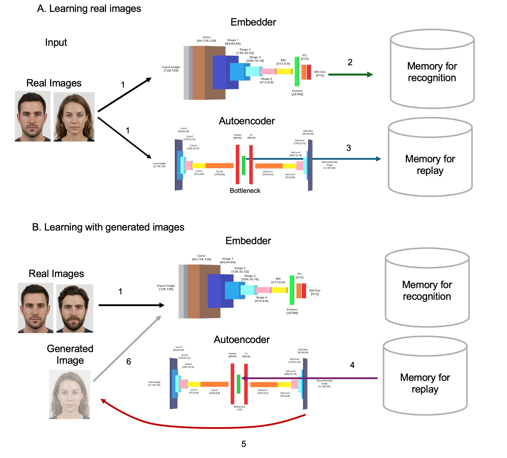

# A developmentally inspired computational model of face recognition that learns continually through generative memory replay

## Paper abstract

The process by which humans achieve their remarkable ability to recognize familiar faces has been extensively studied in children and adults. This ability has been matched by face recognition deep learning algorithms, suggesting a plausible computational model of the human system. Yet the process by which current computational models of face recognition learn faces and the nature of the face datasets they are trained on are very different from human face learning. Here, we propose a computational model that better matches the nature of human face learning. Our proposed model is trained continually with memory replay, by using three interacting modules: an Embedder that encodes face identity; an Autoencoder used for generative memory replay, to construct images of missing identities to prevent forgetting; and a Dual memory module, one for recognition and one for replay. To better match human face experience, we used face images taken from TV series, to simulate the natural, continuous, dynamic stream of human face diet. Testing of this model on a developmentally inspired face diet yielded performance level comparable to learning all faces at once. We propose this new model as a framework for studying the developmental and mature mechanisms of human face recognition.

## Model overview

The model consists of three interacting components:

1. **Embedder** — encodes face images into identity representations.
2. **Autoencoder** — learns latent representations used for generative memory replay.
3. **Dual memory** — maintains an embedding memory for recognition and an Autoencoder memory for replay.



**Figure 1.** A computational model of continual face learning Panel A: 1. The Embedder and the
Autoencoder are trained on real face images (e.g., Mom and Dad) (black arrows). 2. The representations
of the faces generated by the Embedder are stored in memory for recognition (green arrow). 3. The
representations of the faces generated by the Autoencoder ("bottlenecks") are stored in memory for
replay (blue arrow). Panel B: 4. The Autoencoder uses the representations of images of familiar
identities stored in memory for replay (purple arrow). 5. Images of familiar faces are generated by the
Decoder (red arrow). 6. The generated images are used for training the Embedder on identities that are
absent (e.g., Mom) (gray arrow) in addition to new (e.g., Uncle) and old (e.g., Dad) identities that are
present (black arrows). The faces presented in the figure are AI generated images by Gemini.

## Continual-learning - learning steps and sub-steps

The model attempts to simulate how the face-recognition system develops over time. The model implements continual learning, which progresses in "developmental stages" - in each stage the system is introduced to a new identity: it starts with 2 identities, then another identity is added in each stage, until reaching a total of 10 identities in protocol 1 or 8 in protocol 2.

These "developmental stages" are called "learning steps", and within each step the model is trained in sub-steps.

The idea is that each step represents a "period of time" in which the model is learning the current set of identities. For example - first a baby only knows Mom and Dad and her system is trained on their images, then after a while Grandma is acquainted, and there is a period of time when the baby sees only these three identities, then Uncle is introduced and so on.

During the period of time within the learning step, the model is trained on the current step identities. However, in continual learning, the training does not happen on all identities at once: this is to simulate that even though a baby is in the stage of knowing Mom Dad and Grandma, they are not all visually available at the same time (i.e. they are not "standing in front of the baby" at the same time). Therefore, the model is trained on a limited subset of the step's identities using real images, simulating the identities visible at the time of training, and in addition, images of the other identities of the current step are replayed from memory and added to the train data to prevent forgetfulness (see Figure 1 for a graphic explanation). This training happens in what we call "sub-steps". So for example, if in the current step the model "knows" 3 identities, then the training sub-steps may include training on identities [1,2] with real images and [3] with generated images, on identities [1,3] with real images and identity [2] with generated images and so on.

### Training protocols

In the study we report results of two continual learning protocols. The two protocols describe different experimental settings: Protocol 1 is a plain continual learning schedule, going from 2 to 10 identities, where only 2 identities are available for training with real images in each sub-step. Protocol 2 is inspired by real baby first-year data - the maximum number of identities is 8, and 3 of them are always available for real image training.

These two protocols generate different training schedules. In protocol 1 the training sub-steps include all the possible N-choose-2 of the N identities of the step. In each sub-step the model is trained on real images of the chosen 2 identities, and on generated images of the rest of the N identities of the step. In protocol 2 there are 3 constant identities that are always available for training with real images. Therefore there are less sub-steps in each learning step.

## Training modes

The paper describes three separate training modes.

### CL with replay

For continual learning with memory replay the model trains and builds the 4 model components: Autoencoder, Embedder, Autoencoder memory and Embedder memory.

As explained, the Embedder is trained using some generated images. For the model to be able to generate images of identities within a learning step, we must first train the Autoencoder on all the identities of the step. So to enable efficient memory replay we first train the Autoencoder through all the sub-steps of a learning step, and build the Autoencoder memory which stores representations used for image reconstruction.

To this end, the training schedule includes a list of identity pairs representing the sub-steps of the Autoencoder training. Consequently, the Autoencoder training loops over this list, training the Autoencoder model and storing the checkpoints in the sub-step output directory. The training of the next sub-step starts from this saved checkpoint. Following the Autoencoder sub-step training the Autoencoder memory is updated (again - the previous sub-step memory is read and updated using the current Autoencoder, the memory is not built from scratch).

At the end of every Autoencoder learning step the Embedder starts training in a similar way - training in sub-steps on real images of available identities plus generated images of missing identities. Similar to the Autoencoder, the Embedder checkpoint is saved on disk, the next sub-step starts from the previous sub-step, and the Embedder memory is updated using the last trained Embedder.

### Batch

**Batch** training mode is used as a baseline for comparison with the **CL with replay** mode.

Training in batch mode also progresses in learning steps, increasing the number of identities in each step and starting training from the previous model checkpoint. However, in batch mode we train the model in each step on all the step identities at once, as if "they are all standing in front of the baby at once". Therefore in batch training we train only the Embedder, using all real images, and same as before, we build the Embedder memory at the end of each step. There is no Autoencoder training and no generative memory replay.

### Naive CL

**Naive CL** training mode serves as the opposite baseline for comparison with the **CL with replay** mode.

In this mode we use the same training schedule for Embedder training as in CL with replay, but we do not use any generated images, so there is no Autoencoder training and no Autoencoder memory in the model. As a result the Embedder is trained continually in steps and sub-steps, but the identities used for each training sub-step are different, and there is no compensation for missing identities with generated images.

### Training schedules and experimental data

In the study we ran both protocol 1 and protocol 2 training. Each protocol was run 10 times for statistical robustness.

The dataset used in the current study contained train and test images of 20 identities.

The training schedules for the experiment are created using the functions `generate_protocol_1_data` and `generate_protocol_2_data` and the output is stored in `protocol_1_experiment_data.txt` and `protocol_2_experiment_data.txt`.

Each file contains the following data for each run:

```text
identity_list - the indices of the identities used in the current run (indices in the master list of 20 identities)
ae_list - the identities used for Autoencoder training sub-steps in CL with replay mode
embd_list - the identities used for Embedder training sub-steps in CL with replay and Naive CL modes
embd_ae_dependencies - for each Embedder training sub-step in CL with replay mode, what previous Autoencoder sub-step must have been complete
cl_test_indices - checkpoint indices for testing Embedder performance in CL with replay and Naive CL modes (see next section)
batch_list - the identities used for training the Embedder in each step in Batch mode
batch_test_indices - checkpoint indices for testing Embedder performance in Batch mode
```

### Model performance testing

The Embedder is evaluated at the end of each learning step in each of the training modes: **CL with replay**, **Batch** and **Naive CL**.

At each testing checkpoint (indicated by `cl_test_indices` for CL with replay and for Naive CL modes and `batch_test_indices` for batch mode) the Embedder and Embedder memory are used for testing familiar face recognition and unfamiliar face verification.

#### Familiar face recognition

Familiar face recognition is evaluated by taking the checkpoint Embedder, using it to generate embeddings from test images of the step identities, and matching these embeddings to identities stored in the checkpoint's Embedder memory, using a nearest neighbor search.

#### Unfamiliar face verification

Similarly, the Embedder at each testing checkpoint is tested for unfamiliar face verification on the LFW benchmark. The checkpoint Embedder is used to generate embeddings of the test image pairs of the LFW test set. Same-different image pairs are listed in the file `lfw_test_pair.txt`, and the images themselves are stored in the `lfw-align-128` dataset. The verification procedure is the same as the original procedure in the arcface-pytorch repo (appearing in file `arcface_resnet_train.py`).

#### Model performance results

Both the above tests are done by running the function `Baby.test` (in `Baby.py`).

This function writes a file called `performance_all_faces.csv` per testing checkpoint.

The file looks like this:

```text
,cls_name,acc
0,overall,0.96
1,jackson,1.0
2,callie,0.92
3,lfw_acc,0.6186666666666667
```

Where `cls_name` can be either `overall` - indicating the mean recognition accuracy, or `callie` - the recognition accuracy for identity `Callie`, or `lfw_acc` - the maximum accuracy in the LFW verification evaluation.

These files were later manually collected and analyzed for reporting the results in the paper.

### Other results

In addition to familiar face recognition and unfamiliar (LFW) face-verification, the paper reports further analyses:

#### Familiar-face verification

Familiar-face verification uses identities represented in the current Embedder memory.

`generate_face_verification_pairs_all()` in `utils.py` generates:

- 100 same-identity pairs;
- 100 different-identity pairs.

The pairs are written to:

```text
verification_pairs_all.txt
```

and evaluated by `test_verification()` in `Baby.py` using the procedures in `verification_evaluation.py`.

#### Autoencoder image reconstruction error

Autoencoder image reconstruction error is calculated by `calc_generated_images_mse()` in `utils.py` together with `evaluate_mse()` in `Baby.py`.

The procedure calculates image-level mean pixelwise squared reconstruction error and summarizes the results by identity.

## Training and testing data

The face dataset used in this study was prepared from the television series *Grey's Anatomy* and *The Office*.

The extracted face images used in this study are not distributed with the repository because they originate from copyrighted television programs.

However, users can either obtain the same data legitimately or use other data.

The file `video_extract_faces.py` provides the data-preparation procedure:

1. extract video frames;
2. detect and crop faces using DeepFace;
3. organize the extracted faces by identity.

The resulting dataset contained 20 identities, with:

- 1,000 training images per identity;
- 100 held-out test images per identity.

The dataset structure was:

```text
gallery/
├── train/
│   ├── identity_0/
│   ├── identity_1/
│   └── ...
└── test/
    ├── identity_0/
    ├── identity_1/
    └── ...
```

During continual learning, temporary links expose the appropriate training images for each sub-step. Their locations are configured in `config.py`.

### Dataset paths

Before running the experiments, edit the dataset paths in `config.py`:

```python
data_path = '/path/to/cl_data/gallery/'
dataset_link_path = '/path/to/cl_data/links_dir'

lfw_root = '/path/to/lfw-align-128'
lfw_test_list = '/path/to/lfw_test_pair.txt'
```

Here:

- `data_path` is the root directory containing `train/` and `test/`;
- `dataset_link_path` contains the temporary dataset links used during continual learning;
- `lfw_root` is the location of the aligned LFW images;
- `lfw_test_list` points to the `lfw_test_pair.txt` file included in this repository.

## Repository contents

| File | Description |
|---|---|
| `main.py` | Main entry point for the six experimental conditions and reduced example. |
| `continual_learning.py` | Experiment procedures for training, memory construction, replay, and evaluation. |
| `Baby.py` | Main model class and Autoencoder/Embedder training, memory, replay, verification, and evaluation procedures. |
| `Memory.py` | Memory storage, clustering statistics, and reconstruction of representations for replay. |
| `clustering.py` | Clustering procedures used by the memory module. |
| `autoencoder_train2.py` | Autoencoder architecture and training procedure. |
| `arcface_resnet_train.py` | ArcFace-based face-embedding training and testing pipeline. |
| `resnet.py` | ResNet implementation used by the Embedder. |
| `focal_loss.py` | Focal-loss implementation. |
| `metrics.py` | Training and evaluation metrics. |
| `dataset.py` | Dataset utilities for Embedder training. |
| `config.py` | Model, training, and dataset-path configuration. |
| `utils.py` | General data, memory, verification-pair, and evaluation utilities. |
| `verification_evaluation.py` | Face-verification evaluation procedures. |
| `protocol_1_experiment_data.txt` | Protocol 1 identity selections and experimental schedules. |
| `protocol_2_experiment_data.txt` | Protocol 2 identity selections and experimental schedules. |
| `lfw_test_pair.txt` | LFW verification-pair definitions. |
| `video_extract_faces.py` | TV-series face-dataset preparation. |

## Statistical analysis and figures

Data files, statistical analysis R scripts and figures are under `data_files_R_scripts_stats_figures` folder.

Each R script reads the CSV with the same figure number from the working directory, writes the statistics to a text file and saves the figure. Set the working directory to the folder containing the scripts and CSV files, then run, e.g.:

```bash
Rscript figure3_analysis.R
```

Error bars in all figures are ± 1 SE across the 10 runs, except Figure 2 (SE across identities).

| Script | Input | Analysis | Outputs |
|---|---|---|---|
| `figure2_analysis.R` | `figure2_data.csv` | Descriptive only: mean reconstruction error per step, SE across identities. | `figure2.png` |
| `figure3_analysis.R` | `figure3_data.csv` | Separately for each protocol: mixed ANOVA with training mode as a between-run factor and number of identities as a within-run factor (each run is an independent network); Mauchly's test; post hoc comparisons of the three modes within each step (Tukey-adjusted over all mode × step cells, pooled error, Cohen's d). | `figure3_stats.txt`, `figure3.png`, `figure3.pdf` |
| `figure4_analysis.R` | `figure4_data.csv` | As for Figure 3. | `figure4_stats.txt`, `figure4.png`, `figure4.pdf` |
| `figure5_analysis.R` | `figure5_data.csv` | Repeated-measures ANOVA: familiarity × number of identities (both within-run), Greenhouse–Geisser corrected. | `figure5_stats.txt`, `figure5.png`, `figure5.pdf` |
| `figure6_analysis.R` | `figure6_data.csv` | Repeated-measures ANOVA: orientation × number of identities (both within-run), Greenhouse–Geisser corrected. | `figure6_stats.txt`, `figure6.png`, `figure6.pdf` |
| `supp_figure1_analysis.R` | `supp_figure1_data.csv` | Repeated-measures ANOVA: template × number of identities (both within-run; runs paired across templates by identity list), Greenhouse–Geisser corrected. | `supp_figure1_stats.txt`, `supp_figure1.png` |
| `supp_figure2_analysis.R` | `supp_figure2_data.csv` | Repeated-measures ANOVA on 4–8 identities: image type × number of identities (both within-run), Greenhouse–Geisser corrected. The 3-identity step (anchor identities only) is plotted but not analysed. | `supp_figure2_stats.txt`, `supp_figure2.png`, `supp_figure2.pdf` |
| `supp_figure3_analysis.R` | `supp_figure3_data.csv` | Descriptive only (no statistical test). | `supp_figure3.png`, `supp_figure3.pdf` |

The text files report partial η² and, for the GG-corrected analyses, both corrected and uncorrected degrees of freedom. The post hoc comparisons for Figures 3 and 4 (Supplementary Tables 3–6) are included in `figure3_stats.txt` and `figure4_stats.txt`.

### R requirements

R ≥ 4.1 (the scripts use the native pipe `|>`) with the packages `dplyr`, `tidyr`, `ggplot2`, `afex`, `emmeans` and `patchwork`. Each script installs any missing packages on first run.

### Mapping of paper results to data sources

| Paper result | Data source and collection procedure |
|---|---|
| Figure 2: Reconstruction error | Reconstruction error calculated using `calc_generated_images_mse()` in `utils.py` and `evaluate_mse()` in `Baby.py`. Results were collected manually from Protocol 1 CL-with-replay checkpoints for one 10-identity run. |
| Figures 3–4: Recognition performance | `performance_all_faces.csv` files generated at predefined evaluation checkpoints. Results were manually compiled to produce the figures. |
| Figure 5: Familiar/unfamiliar face verification | Verification results collected by running `test_embedder_verification()` on Protocol 1 CL-with-replay checkpoints. Results were manually compiled. |
| Figure 6: Face-inversion effect | LFW verification results for upright and vertically flipped images, evaluated using the same procedure and the same Protocol 1 CL-with-replay checkpoints. Results were manually collected and compiled. The analysis concerns unfamiliar faces only. |
| Supplementary Figure 1: Cluster representative comparison | Results collected from two Protocol 1 CL-with-replay runs, comparing the original cluster-representative selection method with a version using the mathematical mean as the cluster centroid. |
| Supplementary Figure 2: Anchor and non-anchor identities | `performance_all_faces.csv` outputs from Protocol 2 CL-with-replay checkpoints, manually separated into anchor and non-anchor identities. |
| Supplementary Figure 3: Naive continual learning | Recognition results collected from Protocol 1 naive-CL checkpoints and verification results collected using the corresponding verification procedure. |
| Supplementary Tables 3–6: Post-hoc comparisons | Post-hoc comparisons performed manually using the data collected for the corresponding analyses. |

## Installation and configuration

The experiments were developed and tested with Python 3.12.3. Package versions are pinned in `requirements.txt`.

Install the dependencies in a virtual environment:

```bash
python -m venv .venv
source .venv/bin/activate
pip install -r requirements.txt
```

The Embedder requires a CUDA-capable NVIDIA GPU and a compatible NVIDIA driver and CUDA-enabled PyTorch installation.

## Running the experiments

The six experimental conditions are:

1. Protocol 1 + CL with replay
2. Protocol 1 + batch
3. Protocol 1 + naive CL
4. Protocol 2 + CL with replay
5. Protocol 2 + batch
6. Protocol 2 + naive CL

Run the complete experiments with:

```bash
python main.py --base-path outputs
```

The output root can be changed using `--base-path`. Results are organized by protocol, training mode, run, and learning step:

```text
outputs/
├── protocol_1/
│   ├── CL_w_replay/
│   ├── batch/
│   └── naive_CL/
└── protocol_2/
    ├── CL_w_replay/
    ├── batch/
    └── naive_CL/
```

### Reduced example

A reduced Protocol 1 CL-with-replay example is provided:

```bash
python main.py --example
```

It executes the first two continual-learning sub-steps and performs the main pipeline operations:

1. Autoencoder training;
2. Autoencoder memory construction;
3. Embedder training;
4. Embedder memory construction.

Output is written to:

```text
outputs/example/protocol_1/CL_w_replay/
```

The example is intended to verify the pipeline, but does not reproduce the complete experimental results.

## Model parameters

### Memory clustering

Embedder and Autoencoder memories use agglomerative clustering with cosine distance and average linkage.

| Parameter | Embedder memory | Autoencoder memory |
|---|---:|---:|
| Clustering radius | 0.1 | 0.2 |
| Distance threshold | 0.1 | 0.2 |
| `min_samples` | 2 | 2 |

After clustering, clusters are merged until their number is at most 10% of the number of collected embeddings. This limit is separate from the clustering distance thresholds.

### Embedder

| Parameter | Value |
|---|---|
| Input | 128 × 128 grayscale |
| Backbone | ResNet-18 |
| Embedding dimension | 512 |
| Loss | Focal loss with ArcFace margin |
| Optimizer | SGD |
| Batch size | 96 |
| Initial learning rate | 0.1 |
| Weight decay | 5 × 10⁻⁴ |
| Scheduler | StepLR |
| Step size | 10 epochs |
| LR multiplier | 0.1 |
| Maximum epoch setting | 100 |
| Data-loader workers | 4 |

The training loop runs through epochs 1–99 and may terminate earlier according to the stopping criterion.

### Autoencoder

| Parameter | Value |
|---|---|
| Input | 128 × 128 RGB |
| Latent dimension | 100 |
| Batch size | 512 |
| Optimizer | Adam |
| Learning rate | 0.0005 |
| Loss | MSE |
| Epochs | 20 |
| Dropout | 0.4 |
| LR scheduler | None |

The learning rate remains 0.0005 throughout training.

### Generated replay images

The number of replay samples is determined by the cluster sizes stored in Autoencoder memory. Each cluster generates a number of samples equal to its stored `num_vectors` value.

## Computational requirements

The Embedder requires a CUDA-capable NVIDIA GPU and does not provide a CPU fallback. The Autoencoder supports both GPU and CPU execution, although GPU execution is recommended.

As a reference, on an NVIDIA RTX 5000 Ada Generation GPU with 32 GB memory: one autoencoder training sub-step takes about 3 minutes; training the AE for 165 iterations takes around 8 hours. These measurements are approximate and hardware-dependent. Other conditions may have different runtimes.

## Third-party software and data

### ArcFace

The Embedder is based on the ArcFace PyTorch implementation:

[https://github.com/ronghuaiyang/arcface-pytorch](https://github.com/ronghuaiyang/arcface-pytorch)

The ArcFace-related code has been adapted for integration with the present model. Users should consult the upstream repository for licensing and attribution information.

These are the files that were taken and adapted from the arcface-pytorch project:

```text
arcface_resnet_train.py - adapted from original train.py,
resnet.py,
focal_loss.py,
metrics.py,
dataset.py,
config.py,
lfw_test_pair.txt
```

## Licence

The original code in this repository is released under the MIT License. See `LICENSE` for the complete licence text.

Third-party software, datasets, source videos, and extracted television-series images remain subject to their respective licences and terms.

## Citation

If you use this code or model in your research, please cite the accompanying paper:

> A developmentally inspired computational model of face recognition that learns continually through generative memory replay.

Final bibliographic information can be added after publication.

## Archiving

The GitHub repository is the primary location for the source code and documentation.

The final version associated with the published paper will be archived through Zenodo and assigned a DOI.
